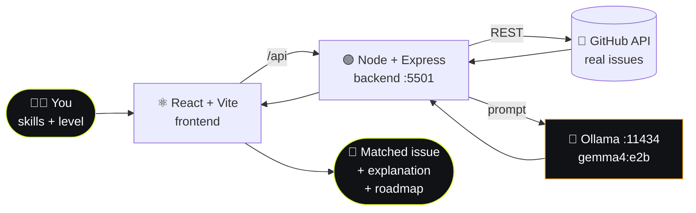
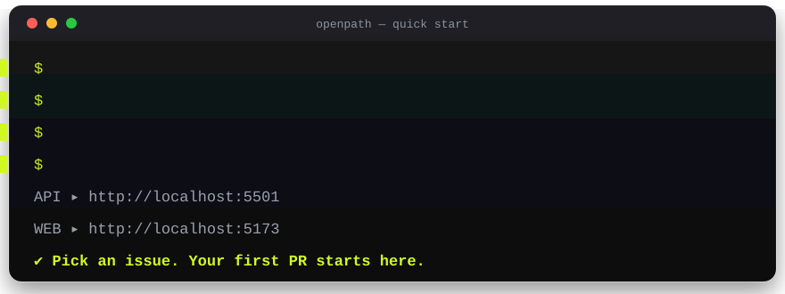

<div align="center">


<br/>

[](https://react.dev)
[](https://vite.dev)
[](https://expressjs.com)
[](https://ollama.com)
[](https://ai.google.dev/gemma)
[](#-license)
[](#-contributing)

### Stop searching. Start contributing.

**OpenPath** matches your skills with *real* GitHub issues, explains them in plain language with an AI that runs **100% on your own machine**, and hands you a step-by-step roadmap to your first pull request.

[**✨ Features**](#-features) &nbsp;•&nbsp; [**🧭 How it works**](#-how-it-works) &nbsp;•&nbsp; [**🔒 Local AI**](#-local-ai-with-gemma--ollama) &nbsp;•&nbsp; [**🚀 Quick start**](#-quick-start) &nbsp;•&nbsp; [**🗺 Roadmap**](#-roadmap)

</div>




## 😵 The problem

Almost every beginner wants to contribute to open source. Almost every beginner gets stuck on the same three questions:

<table>
<tr>
<td align="center" width="33%"><h3>🔍</h3><b>"Which issue is right for me?"</b><br/><sub>Thousands of issues, no idea which ones match your skills.</sub></td>
<td align="center" width="33%"><h3>🧩</h3><b>"What does this even mean?"</b><br/><sub>Maintainer jargon and missing context make issues unreadable.</sub></td>
<td align="center" width="33%"><h3>🚪</h3><b>"Where do I begin?"</b><br/><sub>Fork? Branch? Test? PR? Nobody tells you the order.</sub></td>
</tr>
</table>

**OpenPath removes all three blockers** — it takes you from *finding* an issue to *understanding* it to *knowing exactly how to start*.


## ✨ Features

<table>
<tr>
<td width="50%" valign="top">

### 🔗 Real GitHub issues
Paste any public repository URL and OpenPath pulls its **live issues** through the GitHub API. No mock data, no canned examples.

</td>
<td width="50%" valign="top">

### 🎯 Skill-based recommendations
Tell OpenPath your skills and experience level. It weighs them against issue descriptions and labels to surface issues you can realistically solve.

</td>
</tr>
<tr>
<td width="50%" valign="top">

### 🧠 AI issue explainer
Pick an issue and get a clear breakdown: what the problem is, which skills it needs, and **why it could suit you**.

</td>
<td width="50%" valign="top">

### 🛣 Contribution roadmap
A structured checklist that walks you through understanding the issue, inspecting the repo, making the change, testing it, and preparing a pull request.

</td>
</tr>
<tr>
<td width="50%" valign="top">

### 🔒 Private, local AI
Powered by **Gemma 4 E2B** through **Ollama**. Inference happens on your computer. No hosted AI API, no API key, no data leaving your machine.

</td>
<td width="50%" valign="top">

### ⚡ Full-stack, one command
React + Vite frontend, Node + Express backend, started together with a single `npm run dev`.

</td>
</tr>
</table>

<details>
<summary><b>➕ Also included</b></summary>
<br/>

- **Open Source 101** — bite-sized explanations of repositories, issues, forks, branches, commits and pull requests, with real-world analogies (skippable if you already know Git).
- **Hinglish explanations** — issue breakdowns in plain English or conversational Hinglish.
- **Skill Readiness Card** — your skills are saved locally and compared with each issue's requirements.
- **Verified programs directory** — Google Summer of Code, Hacktoberfest, Outreachy, LFX Mentorship, MLH Fellowship, GirlScript Summer of Code and Season of Docs.

</details>


## 🧭 How it works



| # | Step | What happens |
|:-:|---|---|
| **1** | **Paste a repo** | The backend fetches its real, open issues from GitHub. |
| **2** | **Share your skills** | Skills and experience level are matched against issue text and labels. |
| **3** | **Understand the issue** | Gemma explains the problem, the skills involved and why it fits you. |
| **4** | **Follow the roadmap** | Fork → inspect → implement → test → open your pull request. |


## 🔒 Local AI with Gemma &amp; Ollama

OpenPath doesn't call a hosted AI service. The backend talks to **Ollama** on your machine, so explanations are **private, free to run, and work offline** once the model is downloaded.

| Setting | Value |
|---|---|
| 🧠 Model | `gemma4:e2b` |
| 🦙 Inference server | [Ollama](https://ollama.com) |
| 🔌 Default endpoint | `http://localhost:11434` |
| 🟢 Backend | Node.js + Express on port `5501` |

The backend also runs a **status check** to confirm that Ollama is reachable *and* that the configured model is installed, so you get a clear message instead of a silent failure.

> [!TIP]
> If the model is missing, run `ollama pull gemma4:e2b` and refresh. OpenPath will detect it automatically.


## 🛠 Tech stack

<div align="center">

| Layer | Technology | Purpose |
|:--|:--|:--|
| 🎨 **Frontend** | React + Vite | UI, repository input, recommendations, AI interactions |
| ⚙️ **Backend** | Node.js + Express | API routes, GitHub integration, local AI requests |
| 🐙 **Data** | GitHub API | Fetching real repository issues |
| 🦙 **AI runtime** | Ollama | Hosting the local language model |
| 🧠 **Model** | Gemma 4 E2B | Issue explanations and contribution guidance |
| 🟨 **Language** | JavaScript | Application logic and integration |

</div>


## 🚀 Quick start

<div align="center">

</div>

<details open>
<summary><b>📋 Step-by-step</b></summary>
<br/>

**Prerequisites**

- [Node.js](https://nodejs.org/) v18+ (v20+ recommended)
- [Ollama](https://ollama.com/download), installed and running
- Git

**1 · Clone**

```bash
git clone https://github.com/aayushi2882/openpath.git
cd openpath/openpath
```

**2 · Pull the model**

```bash
ollama pull gemma4:e2b
```

**3 · Install dependencies**

```bash
npm install
npm --prefix server install
```

**4 · (Optional) add a GitHub token**

Unauthenticated GitHub requests are heavily rate-limited. A free token raises the limit a lot.

```bash
cp server/.env.example server/.env
# then set GITHUB_TOKEN=your_token inside server/.env
```

**5 · Run everything**

```bash
npm run dev
```

| Service | URL |
|---|---|
| 🌐 Frontend | http://localhost:5173 |
| ⚙️ Backend API | http://localhost:5501 |
| 🦙 Ollama | http://localhost:11434 |

</details>

### 🧑‍💻 Using OpenPath

1. Make sure Ollama is running.
2. Open the app and paste a public GitHub repository URL.
3. Add your skills and experience level.
4. Browse the recommended issues.
5. Open one for an AI explanation.
6. Follow the roadmap to your first PR.


## 🔌 API reference

| Method | Endpoint | Description |
|:-:|---|---|
| `GET` | `/api/health` | Server uptime, GitHub token status and AI status |
| `GET` | `/api/issues/search` | Search public GitHub issues (`q`, `language`, `label`, `page`) |
| `GET` | `/api/issues/details` | Full issue body plus repository metadata (`owner`, `repo`, `issue_number`) |
| `GET` | `/api/ai/status` | Is Ollama reachable, and is the model installed? |
| `POST` | `/api/ai/explain` | Generate an AI issue explanation |

<details>
<summary><b>📁 Project structure</b></summary>
<br/>

```text
openpath/
├── public/                  # favicon & icons
├── server/
│   ├── src/
│   │   ├── routes/          # ai.js · health.js · issues.js
│   │   ├── services/        # aiService.js · githubService.js
│   │   └── index.js         # Express entry point
│   └── .env.example
├── src/
│   ├── components/          # Hero, IssueDiscovery, AiExplainerModal,
│   │                        # ContributionRoadmap, SkillReadinessCard, ...
│   ├── data/                # guide content & programs directory
│   ├── services/api.js      # frontend API client
│   ├── App.jsx
│   └── main.jsx
├── index.html
├── package.json
└── vite.config.js
```

</details>


## 🗺 Roadmap

- [x] Real GitHub issue discovery
- [x] Skill-based issue recommendations
- [x] AI issue explanations
- [x] Step-by-step contribution roadmap
- [x] Local AI with Gemma 4 E2B via Ollama (with status check)
- [ ] 🔭 **Website inspection with Playwright** — paste a site URL and get AI-suggested UI/UX improvements such as cluttered layouts or missing interface elements

> [!NOTE]
> Website inspection is a **planned** feature and is not part of the current implementation.

## 🤝 Contributing

Contributions are very welcome, and OpenPath is a great place to make your own first one.

1. **Fork** the repository
2. **Create a branch** — `git checkout -b feat/my-idea`
3. **Commit** your changes
4. **Push** and open a **pull request**

## 📄 License

Released under the **MIT License**.


<div align="center">

### Built by **[Aayushi](https://github.com/aayushi2882)** for everyone who's ever wondered where to start.

If OpenPath helped you, a ⭐ on the repo means a lot.

<sub><a href="#">⬆ Back to top</a></sub>

</div>
