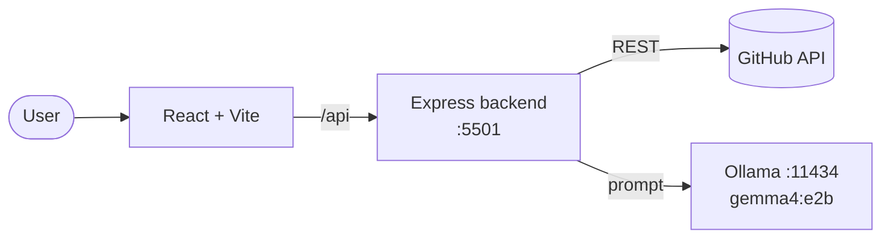

<div align="center">



<br/>


**AI-powered open-source contribution discovery for students and beginner developers.**

[Features](#features) · [How it works](#how-it-works) · [Local AI](#local-ai) · [Getting started](#getting-started) · [Roadmap](#roadmap)

</div>

---

## Overview

Many beginners want to contribute to open source but struggle to find suitable issues, understand what they require, and work out where to start.

OpenPath connects your skills and experience with real GitHub issues, explains each one in plain language, and gives you a clear path from reading the issue to opening a pull request. The AI runs locally on your machine, so no hosted inference API is needed.

## Features

| | |
|---|---|
| **Real GitHub issues** | Enter a public repository URL and OpenPath retrieves its actual issues through the GitHub API. No predefined examples. |
| **Skill-based recommendations** | Provide your skills and experience level. Issues are matched using their descriptions and labels. |
| **AI issue explanation** | Select an issue to see what the problem is, which skills are involved, and why it may suit you. |
| **Contribution roadmap** | A structured set of steps: understand the issue, inspect the repository, implement a change, test it, and prepare a pull request. |
| **Local AI** | Gemma 4 E2B runs on your computer through Ollama. No API key and no data sent to a hosted model. |
| **Full-stack app** | React + Vite frontend with a Node.js + Express backend, started with a single command. |

<details>
<summary>Also included</summary>

<br/>

- **Open Source 101**: short explanations of repositories, issues, forks, branches, commits and pull requests.
- **Hinglish explanations**: issue breakdowns in English or conversational Hinglish.
- **Skill Readiness Card**: your skills are stored locally and compared with each issue.
- **Programs directory**: Google Summer of Code, Hacktoberfest, Outreachy, LFX Mentorship, MLH Fellowship, GirlScript Summer of Code and Season of Docs.

</details>

## How it works



1. **Paste a repository.** The backend fetches its open issues from GitHub.
2. **Add your skills.** They are compared with each issue's text and labels.
3. **Read the explanation.** Gemma summarises the problem and what it takes to solve it.
4. **Follow the roadmap.** Work through the steps to your first pull request.

## Local AI

The backend sends AI requests to Ollama running on your machine.

| Setting | Value |
|---|---|
| Model | `gemma4:e2b` |
| Inference server | [Ollama](https://ollama.com) |
| Default endpoint | `http://localhost:11434` |
| Backend | Node.js + Express, port `5501` |

A status check confirms that Ollama is reachable and that the configured model is installed.

> [!TIP]
> If the model is missing, run `ollama pull gemma4:e2b`.

## Tech stack

| Technology | Purpose |
|---|---|
| React + Vite | Frontend and user interface |
| Node.js + Express | Backend and API routes |
| GitHub API | Fetching repository issues |
| Ollama | Running the local language model |
| Gemma 4 E2B | Explanations and contribution guidance |
| JavaScript | Application logic and integration |

## Getting started

**Requirements:** [Node.js](https://nodejs.org/) 18+, [Ollama](https://ollama.com/download), Git.

```bash
# 1. Clone
git clone https://github.com/aayushi2882/openpath.git
cd openpath/openpath

# 2. Pull the model
ollama pull gemma4:e2b

# 3. Install dependencies
npm install
npm --prefix server install

# 4. Start the frontend and backend together
npm run dev
```

| Service | URL |
|---|---|
| Frontend | http://localhost:5173 |
| Backend | http://localhost:5501 |
| Ollama | http://localhost:11434 |

Optionally, set a `GITHUB_TOKEN` in `server/.env` (copy `server/.env.example`) to raise GitHub's API rate limit.

## API

| Method | Endpoint | Description |
|---|---|---|
| `GET` | `/api/health` | Server and integration status |
| `GET` | `/api/issues/search` | Search public issues (`q`, `language`, `label`, `page`) |
| `GET` | `/api/issues/details` | Issue body and repository metadata |
| `GET` | `/api/ai/status` | Whether Ollama is reachable and the model is installed |
| `POST` | `/api/ai/explain` | Generate an AI issue explanation |

<details>
<summary>Project structure</summary>

```text
openpath/
├── public/
├── server/
│   ├── src/
│   │   ├── routes/       # ai.js, health.js, issues.js
│   │   ├── services/     # aiService.js, githubService.js
│   │   └── index.js
│   └── .env.example
├── src/
│   ├── components/
│   ├── data/
│   ├── services/api.js
│   ├── App.jsx
│   └── main.jsx
├── index.html
├── package.json
└── vite.config.js
```

</details>

## Roadmap

- [x] Real GitHub issue discovery
- [x] Skill-based issue recommendations
- [x] AI issue explanations
- [x] Contribution roadmap
- [x] Local AI with Gemma 4 E2B through Ollama
- [ ] Website inspection with Playwright: provide a URL and receive AI-suggested UI/UX improvements, such as cluttered layouts or missing interface elements

> [!NOTE]
> Website inspection is planned and is not part of the current implementation.

## Contributing

Contributions are welcome. Fork the repository, create a branch, commit your changes and open a pull request.

## License

MIT

---

<div align="center">
<sub>Built by <a href="https://github.com/aayushi2882">Aayushi</a></sub>
</div>
