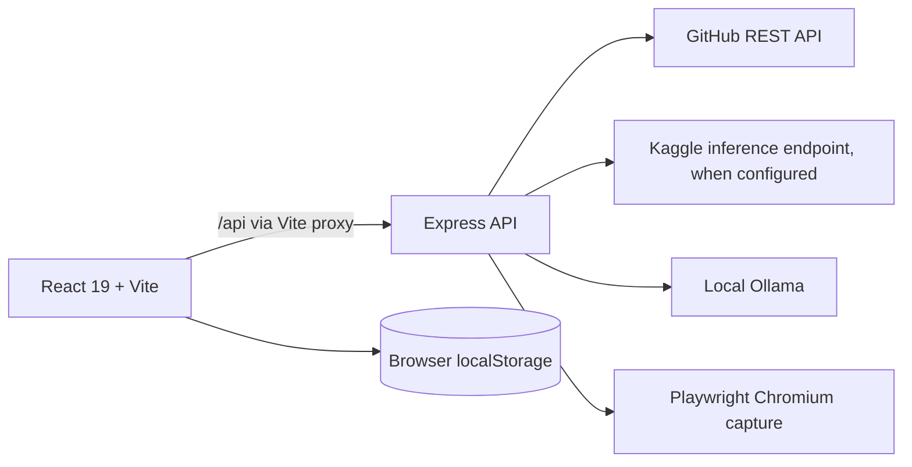

# OpenPath System Architecture

## Current architecture (verified from source)

The `Kaggle` and `Ollama` edges are not uniform: issue AI in `server/src/services/aiService.js` can use Kaggle and fall back to Ollama; website analysis in `server/src/services/websiteAnalysisService.js` calls Ollama directly. Runtime smoke checks confirmed Express and GitHub access; local AI was unreachable.

## Module map

- **Client shell and navigation:** `src/main.jsx`, `src/App.jsx`; screen selection is local React state, not URL routing.
- **Client API:** `src/services/api.js`; requests use same-origin `/api` unless `VITE_API_BASE_URL` is set.
- **Development proxy:** `vite.config.js`; frontend port 5173 proxies `/api` to backend port 5501 by default.
- **Server setup/middleware:** `server/src/index.js`; Express JSON body parser, permissive CORS, request log, route mounts and error handlers.
- **Routes:** `server/src/routes/{health,issues,repositories,ai,websiteAnalysis}.js`.
- **GitHub service:** `server/src/services/githubService.js` calls GitHub REST API directly and maps repository/issue data.
- **AI service:** `server/src/services/aiService.js` implements issue explanation, issue recommendations and provider selection.
- **Website capture/analysis:** `server/src/services/websiteAnalysisService.js` uses Playwright, URL/DNS checks, a custom proxy, evidence extraction, and Ollama.
- **Persistence:** browser `localStorage` for skills, experience and roadmap checklist. There is no server database or job queue.

## Current API surface

| Method / route | Purpose |
|---|---|
| `GET /api/health` | API uptime, GitHub token configured flag, AI status. |
| `GET /api/ai/status` | Current configured AI provider/model readiness. |
| `POST /api/ai/explain` | Generate a structured explanation for an issue. |
| `POST /api/ai/recommend` | Recommend among supplied real issues. |
| `GET /api/issues/search` | Search GitHub issues. |
| `GET /api/issues/details` | Load one issue and repository details. |
| `GET /api/repositories/search` | Search public GitHub repositories. |
| `GET /api/repositories/:owner/:repo` | Load repository metadata and onboarding docs. |
| `GET /api/repositories/:owner/:repo/issues` | Search open issues in one repository. |
| `POST /api/website-analysis/analyze` | Synchronously capture and analyze one public website URL. |

Routes/response envelopes are not fully consistent. No authentication is currently implemented; do not imply authenticated access controls exist.

## Not present in current architecture

No database, migrations, Redis/queue, persistent scan jobs/reports, isolated browser worker, user authentication, provider credential store, CI, deployment topology, or monitoring configuration was found. These are roadmap targets or decisions, not existing components.
